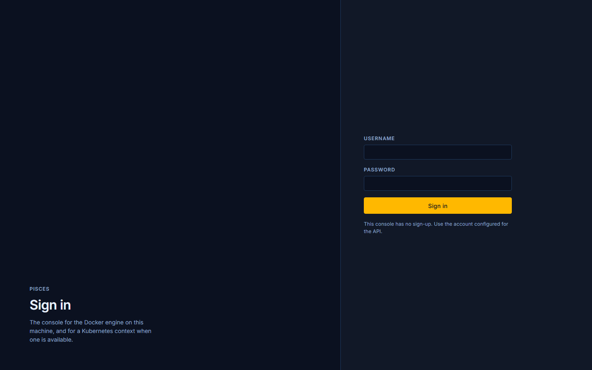
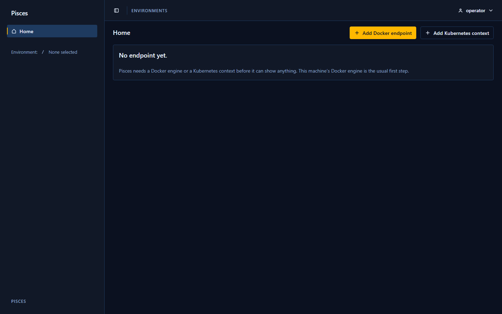
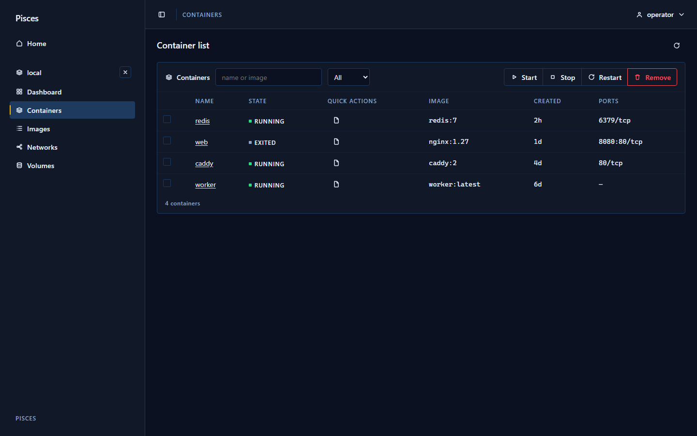
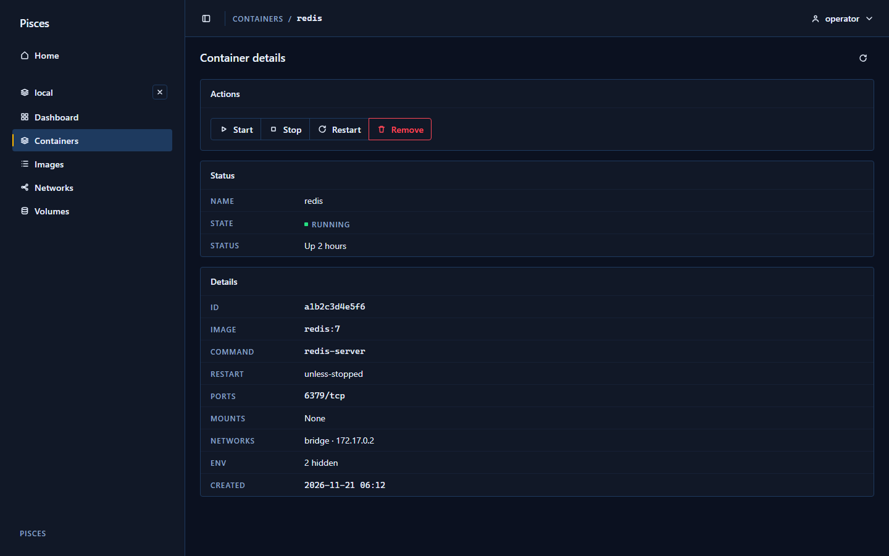

<p align="center">
  
</p>

# Pisces

A Portainer-like web app for managing Docker from a browser: a **Next.js** frontend and a
**Rust** backend that provides authenticated API control over the Docker daemon.

The Docker slice (TELE-73) is the working console: sign in, add this machine's engine, and
start, stop, inspect, and remove containers, plus images, volumes, and networks.
Kubernetes is not delivered yet — the Kubernetes nav routes render a "not in this build"
placeholder, and the only Kubernetes thing that works is saving a context.

## Screens

Screens from the approved UI/UX layout.


*Sign in — one operator account, configured on the container, no sign-up.*


*Home with no endpoint yet — add this machine's Docker engine, or save a Kubernetes context.*


*Containers — state, image, created, and ports, with start/stop/restart/remove.*


*Container detail — actions, status, and the inspect fields.*

The mark in the README is the app icon: `frontend/app/icon.svg` is the source, and the same
art is wired as the favicon, the Apple touch icon, and the 192/512 icons in the web app
manifest.

## Deploy

One Linux image runs the UI and the API. Publish port 3000, mount the engine socket, and give the container a username and password:

```
docker run -d --name pisces --restart unless-stopped -p 3000:3000 -v /var/run/docker.sock:/var/run/docker.sock -v pisces-data:/data -e PISCES_USERNAME=admin -e PISCES_PASSWORD=choose-a-password ghcr.io/chakyiu/pisces:latest
```

Open `http://localhost:3000` and sign in with those values. The API inside the image listens only on `127.0.0.1:8787`; the UI proxies `/api`. The process runs as root so it can use the socket. Endpoint names are stored in the `pisces-data` volume, and the first start writes a session signing key there so restarts keep sessions.

The backend accepts either form of the password. `PISCES_PASSWORD_HASH` (an argon2 PHC string) wins when set; otherwise the backend hashes `PISCES_PASSWORD` once at startup and keeps only the hash in memory. The plaintext still stays on the container, so it shows up in `docker inspect` — pass `-e PISCES_PASSWORD_HASH=...` instead if that matters.

`docker build -t pisces .` from this repo builds the same image. Use `pisces` in the command above instead of `ghcr.io/chakyiu/pisces:latest`.

Pushes to `main` publish `ghcr.io/chakyiu/pisces:latest` and `ghcr.io/chakyiu/pisces:sha-<short>`. A `vX.Y.Z` git tag also publishes that version and `X.Y`.

## Layout

```
backend/    Rust API server (axum), Docker client (bollard), Kubernetes client (kube)
frontend/   Next.js App Router app (TypeScript)
```

## Prerequisites

- Rust 1.85+ (`cargo check` was verified on 1.100.0)
- Node.js 20+ and npm
- Docker Desktop, running, for anything that talks to Docker
- A kubeconfig only if you actually want Kubernetes; no cluster is required to build

## Dev loop (Windows, two terminals)

Backend, from `backend/` — listens on `http://127.0.0.1:8787`. Set the variables
in the shell before `cargo run`. Do not commit them.

- `PISCES_USERNAME` — the single operator name
- `PISCES_PASSWORD` — plain password; hashed once at startup, then only the hash is kept
- `PISCES_PASSWORD_HASH` — argon2 PHC string from `cargo run -- hash-password` (password on stdin); wins over `PISCES_PASSWORD` when set
- `PISCES_JWT_SECRET` — 32 or more characters, used only to sign the session cookie

Set at least one of them: neither password variable is a startup error. A value that is
not a PHC string in `PISCES_PASSWORD_HASH` is rejected at startup. The startup line
reports which variable was used; the plaintext is never logged.

```powershell
cargo run -- hash-password
cargo run
```

Frontend, from `frontend/` — listens on `http://localhost:3000`. The browser talks to
`/api/*` on that origin; Next proxies to `PISCES_API_URL` (default `http://127.0.0.1:8787`)
so the session cookie stays on port 3000.

```powershell
npm install
npm run dev
```

Open `http://localhost:3000`, sign in, and add a Docker endpoint named `local`. The engine
is always this machine. Endpoint names are stored in `PISCES_DATA_DIR` (default `data/`).

Checks:

```powershell
cd backend;  cargo check
cd frontend; npm run build
```

## Decisions

**Docker client — `bollard` 0.21.1.** Talks the daemon HTTP API directly; on Windows it
reaches Docker Desktop over the named pipe `//./pipe/docker_engine`
(`Docker::connect_with_named_pipe_defaults()`), on Linux/macOS over the local socket.
Client construction is lazy, so a stopped daemon breaks requests, not startup.

**Kubernetes — `kube` 5.1.0 + `k8s-openapi` 0.29.0 (feature `v1_34`).** Dependencies only:
no cluster is assumed. The API snapshot is pinned via the `k8s-openapi` feature so types do
not drift under us.

**Auth.** Local password hash with `argon2` 0.6.0, and an 8-hour bearer JWT with
`jsonwebtoken` 12.0.0 in the httpOnly cookie `pisces_session` (`SameSite=Lax`, not
`Secure`, because the dev console is plain HTTP on localhost). `POST /api/session` signs
in, `DELETE /api/session` signs out, and every other `/api` route except `GET /api/health`
rejects a missing or bad cookie with 401. No secret file is committed.

## Secrets

Nothing in this repo needs a credential to build. Do not commit tokens, passwords, or `.env`
files; `.gitignore` already excludes `.env` and `.env.*`.
